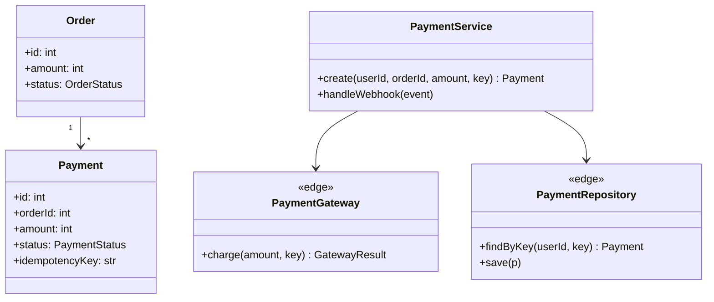
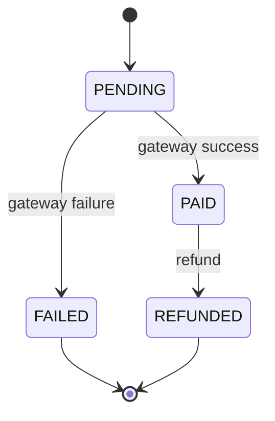

# Payments: diagrams, schema and tests

## docs/arch-payment.md (written before code)





`PaymentGateway` and `PaymentRepository` are edges (network, DB); `PaymentService` and the transition table are pure enough to unit test with fakes.

## Schema

```sql
CREATE TABLE payments (
  id INTEGER PRIMARY KEY,
  user_id INTEGER NOT NULL,
  order_id INTEGER NOT NULL,
  amount INTEGER NOT NULL CHECK (amount > 0),   -- minor units (원)
  status TEXT NOT NULL,
  idempotency_key TEXT NOT NULL,
  request_hash TEXT NOT NULL,                    -- hash of the request body, to catch a reused key with a different body
  response_json TEXT,                            -- NULL while the first request is still in flight
  UNIQUE (user_id, idempotency_key)              -- unique per caller, so one user can never read another's response
);
CREATE TABLE webhook_events (
  event_id TEXT PRIMARY KEY,                     -- gateway event id, makes delivery idempotent
  received_at TEXT NOT NULL
);
```

## Flow

1. Read `Idempotency-Key`; reject the request with 400 if it is missing.
2. In one transaction, insert the payment as `PENDING` with the caller's id, the key and the request hash. A unique-constraint error means a retry: load that row; a different `request_hash` gets 422, a NULL `response_json` (first request still in flight) gets 409, otherwise return the stored `response_json`.
3. Call the gateway with the same key (most gateways accept one), store the result and the response, move the status through the transition table.
4. A row left `PENDING` with no response (the process died during the gateway call) is resolved by querying the gateway with the same key, from a retry after a timeout or a periodic job; otherwise its retries get 409 forever.

## State machine

```python
TRANSITIONS = {"PENDING": {"PAID", "FAILED"}, "PAID": {"REFUNDED"}}

def transition(current: str, new: str) -> str:
    if new == current:  # the sync response and the webhook can both report PAID; the second is a no-op
        return current
    if new not in TRANSITIONS.get(current, set()):
        raise ValueError(f"illegal transition {current} -> {new}")
    return new
```

## Webhook

Verify the signature (HMAC of the raw body with the gateway secret, compared with `hmac.compare_digest`) before parsing. Reject a timestamp outside the gateway's tolerance (often 5 minutes). Insert `event_id` into `webhook_events` and apply the state change in the same transaction; on a duplicate `event_id`, return 200 and do nothing.

## Tests

```python
def test_same_key_charges_once(self):
    r1 = post("/payments", {"orderId": 1, "amount": 10000}, key="k-1", user=1)
    r2 = post("/payments", {"orderId": 1, "amount": 10000}, key="k-1", user=1)
    self.assertEqual(r1.json(), r2.json())
    self.assertEqual(fake_gateway.charges, 1)

def test_same_key_other_body_is_rejected(self):
    post("/payments", {"orderId": 1, "amount": 10000}, key="k-1", user=1)
    self.assertEqual(post("/payments", {"orderId": 1, "amount": 99}, key="k-1", user=1).status, 422)

def test_webhook_delivered_twice_changes_state_once(self):
    deliver(event_id="evt-1", type="payment.paid")
    deliver(event_id="evt-1", type="payment.paid")
    self.assertEqual(status_history(payment_id), ["PENDING", "PAID"])
```
