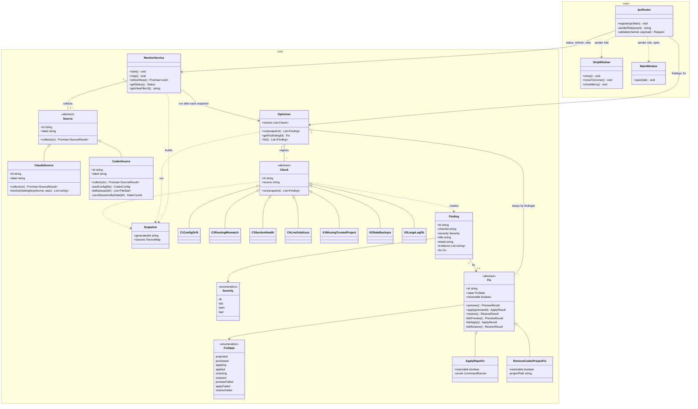
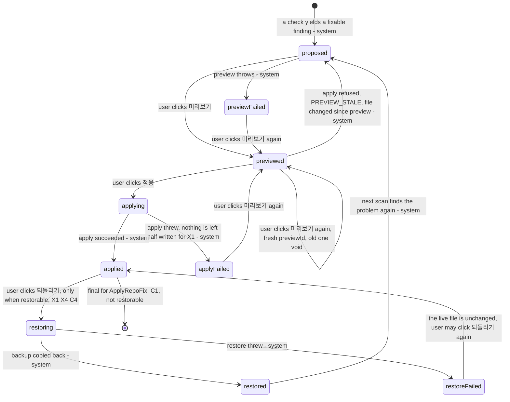

# Architecture: Claude Monitor (desktop app)

Spec: `docs/spec-claude-monitor.md`. IPC contract: `docs/api-claude-monitor.md` (the preload API is defined there and nowhere else).
The code follows the diagrams below; a change to the design changes the diagram first.

Scope notes
- The app runs from this repository checkout (`app/core` imports `../../scripts/monitor.mjs` and `ApplyRepoFix` runs `scripts/apply.sh` from the repo root). Packaging is out of scope.
- `app/package.json` already exists (`"type": "module"`, `"main": "main/main.js"`, Electron pinned to `44.7.0`, script `node --test test/`). The layout below fits it.
- Reuse, not redesign: `collect()`, `summarize()` in `scripts/monitor.mjs` and `render()` in `scripts/monitor-html.mjs` are called as they are. One change is needed outside this task: `writeAtomic` in `scripts/monitor.mjs` is not exported (plain `function`); it needs the single word `export` (see Open issues in the hand-off). Until then `app/core` must not copy it.

## 1. Class diagram

Namespaces are labels only: `core` is `app/core/` (plain Node, runs under `node --test` on Linux CI with no Electron binary), `main` is `app/main/` (Electron main process). Relations are drawn outside the namespace blocks.
Shapes that Mermaid cannot hold inside a member (objects, unions) are described in the prose under the diagram.



Shapes (prose, the contract file has the wire form)
- `SourceResult`: `{ status: ok|warn|missing, note: string, data }`. A Source never throws out of `collect`; a failure becomes `status: missing` with a fixed note (same `guard` idea as `collect()`).
- `ClaudeSource.collect(ctx)` calls `collect({ home, repo, env, cache, refreshSec })` from `scripts/monitor.mjs` unchanged and keeps its result as `data` (plus `summary = summarize(data)`, plus `liveOnlyKeys`: top-level key names of live `settings.json` that are absent from the repo `claude/settings.json`; names only, never values).
- `CodexSource.collect(ctx)` reads `~/.codex` read-only. `data` is `{ config, backups, logs, sessions }` (see section 6).
- `ctx` is `{ now, homes: { claude, codex }, repo, env, cache }`. Clock, paths and env are passed in, never read inside a Check.
- `PreviewResult`: `{ diff: string, previewId: string }`. `ApplyResult`: `{ backupPath?: string }`. `RestoreResult`: `{ restored: true }`.
- `Finding.fix` is absent for report-only findings. `Finding.id` is stable across scans: `C1:drift`, `C2:<agentType>`, `C3:<section>`, `C4:live-only`, `C5:hook-scripts`, `X1:<first 12 hex of sha1 of the project path>`, `X2:backups`, `X3:logs`, `X4:<sha1 12 of the hook key>`, `X5:<server name>`, `X6:worktrees`.
- `Fix` is a template: the public `preview/apply/restore` enforce the transition table of section 2 (one table, anything else throws `INVALID_STATE`), then call the protected `do*` of the subclass. `restorable` is false for `ApplyRepoFix`.
- `Optimizer.run` keeps `Fix` objects that are in `previewed`, `applying`, `applied`, `restoring` or a failed state across scans (so "되돌리기" stays visible after the finding itself is gone) (a kept `previewed` fix lets the user read the diff past one refresh; `apply` recomputes the preview id, so a changed target answers `PREVIEW_STALE`); `proposed` fixes are replaced by fresh ones. Only one fix may be in `applying` or `restoring` at a time (`FIX_BUSY`). State lives in memory only.
- `CommandRunner` is a function `(file, args, opts) -> Promise<{ code, stdout, stderr }>` passed to `ApplyRepoFix`; it is the test seam that lets a test prove `apply.sh` is the only command run. Same for the clock passed to `MonitorService` (fake timers) and the injected `ipcMain` of `IpcRouter`.

Ponytail check on abstractions: `Source` has two real implementations (Claude, Codex), `Check` has seven, `Fix` has two. No other interface or factory exists. `TomlLite` (section 6) is a module of functions, not a class.

### What lives where

| Layer | Folder | Classes | Needs Electron |
|---|---|---|---|
| Core | `app/core/` | Source, ClaudeSource, CodexSource, Snapshot, Check and C1..C4, X1..X3, Finding, Severity, Fix, FixState, ApplyRepoFix, RemoveCodexProjectFix, Optimizer, MonitorService | no |
| Main | `app/main/` | StripWindow, MainWindow, IpcRouter, `main.js` (wires everything, single-instance lock) | yes, except `IpcRouter` |

`IpcRouter` receives `ipcMain` and a `senderRole(event)` function as arguments and never imports `electron`, so its validation and permission rules are tested on CI with a fake `ipcMain`. `MonitorService` is in `core` because it needs only timers, files and the injected Sources; Electron only subscribes to its change callback.

`MonitorService` per tick (one `setInterval(refreshSec)`, default 10 s, minimum 3 s like `parseArgs` in `scripts/monitor.mjs`):
1. If no run is in flight, start one: `snapshot = await Promise.all(sources.collect)`, `Optimizer.run(snapshot)`.
2. `render(claudeData)` (called with `refreshSec` so the page reloads itself), add the monitor-frame CSP meta tag (section 6), and write `claude-monitor.html` with `writeAtomic`; write `status.json` = `summarize(claudeData)` with `writeAtomic` (same shape the old `scripts/monitor-bar.ps1` reads).
3. Re-emit the status on every tick, even while a run hangs, so "모니터 멈춤" appears when `now - generatedAt > 3 x refreshSec`.
Output folder is `app.getPath('userData')` passed in by `main.js` (a per-user folder, not the shared temp folder), so another local process cannot plant the html the app displays.

## 2. Fix lifecycle

Every fix goes one at a time: preview, then a user click on apply, then (X1, X4 and C4) a user click on restore. "최적화하기" previews the picked fixes first and then applies them one after another through the same calls; it stops at the first `PREVIEW_STALE` or `FIX_BUSY`. X1/X4 preview ids hash only the target table, so applying one of them does not make the next one stale. The renderer sends only `findingId` and `previewId`; `IpcRouter` resolves the `Fix` through `Optimizer.getFix` and never takes paths, commands or diffs from the renderer.



| From | To | Moved by | Guard |
|---|---|---|---|
| (start) | proposed | a Check yields a finding that has a Fix | finding id new or fix was not kept |
| proposed | previewed | user: 미리보기 (`fix:preview`) | no other fix applying or restoring |
| previewed | applying | user: 적용 (`fix:apply` with `previewId`) | recomputed `previewId` equals the sent one; else `PREVIEW_STALE` and state returns to proposed |
| applying | applied / applyFailed | system, when the work ends | X1: backup written first, then atomic rename |
| applied | restoring | user: 되돌리기 (`fix:restore`) | `restorable` is true; current `config.toml` hash equals the hash right after apply, else `RESTORE_CONFLICT` and state stays applied |
| restoring | restored / restoreFailed | system, when the work ends | |
| applied (C1) | end | none | `ApplyRepoFix.restorable = false`: `apply.sh` keeps no backup (git is the history); `fix:restore` answers `NOT_RESTORABLE` |

Fix classes
- `ApplyRepoFix` (C1): `preview` runs `bash scripts/apply.sh --dry-run` in the repo root and returns its output as `diff`; `previewId = sha256(output)`. `apply` re-runs the dry run, compares the hash, then runs `bash scripts/apply.sh`. It never opens a file under `~/.claude` for writing; the only command it may run is `bash scripts/apply.sh` with optional `--dry-run` (checked by a test with a fake `CommandRunner`). `ApplyResult` has no `backupPath`.
- `RemoveCodexProjectFix` (X1): removes exactly one table `[projects.'<path>']`: the header line and the key lines after it up to the line before the next `[` or `[[` header; the blank separator line stays. Line endings of the file are preserved. `preview` returns the removed lines as `diff` (values of keys that match the secret pattern are masked as `***`; a `projects` table normally holds only `trust_level`) and `previewId = sha256(raw text of that table)`, so edits elsewhere in the file (by Codex or by another X1/X4 apply) do not make it stale. `apply` re-reads `config.toml` and re-hashes the table (`PREVIEW_STALE` if it differs or is gone), copies it to `~/.codex/backups/claude-monitor/<YYYYMMDD-HHmmss>-config.toml`, writes the new text to a temp file in `~/.codex` and renames it over `config.toml`, then stores `backupPath` and the new hash in memory. `restore` checks that hash, copies the backup back the same way (temp file + rename). Known limit: Codex itself may write `config.toml` between the hash check and the rename; the window is milliseconds and the backup covers it.

## 3. Extension recipe

Adding a check = 2 steps, one registry line.
1. Create `app/core/checks/c6-something.js` with `export class C6Something extends Check` (set `id`, `source`, implement `run(snapshot)` returning `Finding[]`; add a test in `app/test/` using a fixture).
2. Add one line to `app/core/checks/index.js`: `export { C6Something } from './c6-something.js';`

`index.js` holds only those export lines. `Optimizer` builds its registry with `Object.values(await import('./checks/index.js'))` and `new` on each, so there is no second list to edit. A test asserts that every export extends `Check` and that all `id` values are unique.

Adding a source is the same: `app/core/sources/<name>-source.js` (`export class FooSource extends Source`) plus one line in `app/core/sources/index.js`. `MonitorService` instantiates every export of that index; the snapshot gets `sources.<id>`. Checks name their source with `source = '<id>'`.

Adding a fix: a class in `app/core/fixes/` extending `Fix`, returned from the check through `Finding.fix`. No registry.

## 4. Checks mapped to classes

All finding texts shown to the user are Korean (project language); ids, evidence keys and code are English.

| Spec | Class (file in `app/core/checks/`) | Source | Reads | Finding(s) | Severity | Fix |
|---|---|---|---|---|---|---|
| C1 config drift | `C1ConfigDrift` (`c1-config-drift.js`) | claude | `data.setup.driftCount`, `data.setup.drift` (relative paths, max 10 as evidence) | `C1:drift` | warn when `driftCount > 0` | `ApplyRepoFix` |
| C2 routing mismatch | `C2RoutingMismatch` (`c2-routing-mismatch.js`) | claude | `data.routing.agents` with `verdict === 'mismatch'` | one `C2:<agentType>` each (expected family, models seen as evidence) | warn | none |
| C3 section health | `C3SectionHealth` (`c3-section-health.js`) | claude | `status` of `plugins`, `hooks`, `claudeMem`, `rtk` | one `C3:<section>` per section that is not `ok`; detail ends with a fixed next-step sentence per section | `warn` section status gives warn; `missing` gives bad (same order as `summarize()`) | none |
| C4 live-only keys | `C4LiveOnlyKeys` (`c4-live-only-keys.js`) | claude | `liveOnlyKeys` from `ClaudeSource` | `C4:live-only` (key names as evidence) | info | `AdoptLiveKeysFix`: copies the importable keys into repo `claude/settings.json` only (never the live file; secret-capable keys such as `env` are excluded), restorable |
| C5 missing hook script | `C5MissingHookScript` (`c5-missing-hook-script.js`) | claude | `missingHookScripts` (live and repo hooks whose script file is missing) | `C5:hook-scripts` (scope, event, path; never the command text) | warn | none |
| X1 missing trusted project | `X1MissingTrustedProject` (`x1-missing-trusted-project.js`) | codex | `data.config.projects` (path list), existence checked in `CodexSource` with `fs.existsSync` | one `X1:<sha1 12>` per vanished path (temp folders included) | warn | `RemoveCodexProjectFix` |
| X2 stale backups | `X2StaleBackups` (`x2-stale-backups.js`) | codex | `data.backups` (names matching `config.toml.bak*`) | `X2:backups` when count >= 3 | info | none |
| X3 large log db | `X3LargeLogDb` (`x3-large-log-db.js`) | codex | `data.logs` (`logs_*.sqlite` sizes from `fs.statSync`) | `X3:logs` when any size >= 500 MB | warn | none |
| X4 missing hook state | `X4MissingHookState` (`x4-missing-hook-state.js`) | codex | `data.config.hookList` with `exists === false` | one `X4:<sha1 12>` per stale `[hooks.state.'<key>']` table | warn | `RemoveCodexTableFix` |
| X5 MCP without transport | `X5McpNoTransport` (`x5-mcp-no-transport.js`) | codex | `data.config.mcpList` enabled with no `command` or `url` | one `X5:<name>` each | warn | none |
| X6 many worktrees | `X6ManyWorktrees` (`x6-many-worktrees.js`) | codex | `data.worktrees` (count, oldest mtime) | `X6:worktrees` when count >= 20 or the oldest is over 30 days | info | none |

The severities of C3 and X2 are proposals the spec does not fix; each is one constant in its check file.

Status counts: "확인 필요 N" counts findings with severity `warn`, "문제 N" counts `bad`. `ok` and `info` are listed in the 최적화 tab but not counted. Details of the status state are in the contract file.

## 5. Folder layout

```text
app/
  package.json            exists: type module, main main/main.js, electron 44.7.0, script "node --test test/"
  main/
    main.js               wiring, single-instance lock, security switches (section 6)
    strip-window.js       StripWindow
    main-window.js        MainWindow
    ipc-router.js         IpcRouter (no `electron` import)
  preload/
    preload.cjs           exposes window.monitor, exactly the API of docs/api-claude-monitor.md
  renderer/               markup, styles, UI code: owned by publisher/designer, not by this contract work
    strip/                index.html, strip.css, strip.js
    main/                 index.html, main.css, main.js (shell: 9 tabs, iframe for the 7 monitor tabs, codex and optimize panels)
  core/
    source.js  snapshot.js  check.js  finding.js  fix.js  optimizer.js  monitor-service.js
    toml-lite.js          line-based reader for ~/.codex/config.toml (functions only)
    sources/              index.js (registry), claude-source.js, codex-source.js
    checks/               index.js (registry), c1-...js .. c4-...js, x1-...js .. x3-...js
    fixes/                apply-repo-fix.js, remove-codex-project-fix.js
  test/
    *.test.js             node:test files: sources, checks, optimizer, fixes, toml-lite, ipc-router, monitor-service
    fixtures/
      codex/              fake ~/.codex: config.toml (with a SENTINEL secret key), backups/, logs_*.sqlite stubs, sessions tree
      claude/             fake ~/.claude and a small repo copy for C1..C4
```

`preload.cjs` is CommonJS on purpose: `package.json` has `"type": "module"`, and a sandboxed preload cannot be an ES module (stated from memory of the Electron docs, not checked against 44.7.0; the implementer verifies it when the window is first opened).
The existing script `"test": "node --test test/"` may not discover files the same way on every Node version (a directory argument became a glob/path argument in newer Node lines; not verified). Prefer plain `node --test` run in `app/`, which discovers `test/**/*.test.js`; report if the script needs changing.

CI: `cd app && node --test` runs on Linux with Node 20 or newer and without the Electron binary, because nothing under `app/core/`, `app/test/` or `app/main/ipc-router.js` imports `electron`. Sources get their home directories through `ctx`, so tests point `homes.codex` at `test/fixtures/codex` (copied to a temp dir for the fix tests, which write) and `homes.claude` at `test/fixtures/claude`. The Electron-bound files (`main.js`, windows) are covered by a manual smoke run, not by CI.

Required tests (each maps to a spec acceptance item)
- Spec 5: X1 fix on a temp copy of the fake `~/.codex`: preview, apply creates the backup file, restore returns the original bytes; `PREVIEW_STALE` after an edit between preview and apply; `RESTORE_CONFLICT` after an edit between apply and restore.
- Spec 6: C1 fix with a fake `CommandRunner` records exactly `bash scripts/apply.sh --dry-run` then `bash scripts/apply.sh`, and a fake `~/.claude` is byte-identical after `preview()`; `restore()` rejects with `NOT_RESTORABLE`.
- Secrets: the fixture `config.toml` holds keys such as `api_key`, `access_token`, `client_secret`, `password` and an `[mcp_servers.x.env]` table with `GITHUB_PAT`; the test serializes the whole snapshot, every finding and every diff to JSON and asserts the sentinel values never appear.
- Registry: every export of `checks/index.js` extends `Check`; ids unique; every finding id matches the id pattern of the contract.
- `IpcRouter`: wrong sender role gives `FORBIDDEN`, malformed ids give `BAD_REQUEST`, thrown errors never reach the renderer as raw messages.
- Status states: fake clock gives `starting`, `stale` (after 3 periods), `ok`, `warn`, `bad`, `nodata`.

## 6. Security notes

Files and values the app never reads
- `.credentials*`, `.env*`, `~/.codex/auth.json`, `~/.codex/secrets/`, `~/.codex/.sandbox-secrets/`, any key, token or password value.
- Session text: Claude transcripts go through the existing whitelist in `scripts/monitor.mjs` (`parseTranscriptLine`); Codex sessions are counted from directory and file names, with `mtime` as fallback, and their contents are never opened. Their layout is assumed to be a dated tree under `~/.codex/sessions` (not verified on this machine); the date comes from path segments or the file name, else from `mtime`.
- Payloads and logs carry counts, states, key names and the paths of Codex trust tables only (X1 evidence). Main-process logs are key=value lines with counts and finding ids, never evidence text.

`CodexSource` config reading (`core/toml-lite.js`): line based, two layers.
1. Allowlist: values are returned only for the keys in `SETTING_KEYS` of `toml-lite.js` (`model`, `model_reasoning_effort`, `approval_policy`, `sandbox_mode`, `service_tier`, `approvals_reviewer`, `default_subagent_model`, `default_subagent_reasoning_effort`, `max_concurrent_threads_per_session`, `mcp_optional_startup_grace_ms`; from the top level or the first table that is not a secret, env, project, hook, plugin or MCP table), `trust_level` in `projects` tables and `enabled` in `plugins.*` and `mcp_servers.*` tables (key names are the Codex names as the spec's wording implies; verify against a real `config.toml` when writing the fixture). Every other key yields its name only, or nothing; tables such as `mcp_servers.<name>` and `plugins.<name>` are only counted, and nested env tables (`mcp_servers.<name>.env`) are never read, since a name like `GITHUB_PAT` would pass a pattern filter.
2. Deny regex `/key|token|secret|password/i` on the key name: a matching key never returns a value, even if it were on the allowlist.
Multi-line strings and arrays are skipped by their delimiters so a line inside a string is never mistaken for a header. Files larger than 1 MB are not read (the finding says so). shortcut: no full TOML grammar (inline tables and dotted keys on one line are not read), upgrade to a TOML library only if a check needs nested values.
X2 and X3 use `readdir` and `stat` only (no file is opened). The C4 finding carries key names only; its preview diff shows the values of the importable keys, which never include secret-capable keys.

Electron switches (set in `main.js` and the two window classes)
- `contextIsolation: true`, `nodeIntegration: false`, `sandbox: true`, `webSecurity` left on, `enableRemoteModule` absent; both windows use the same `preload.cjs`; it exposes only the frozen `window.monitor` object of the contract, never `ipcRenderer` and never the IPC event object.
- Local files only: windows load `file://` pages from `app/renderer/`; `will-navigate` and `will-frame-navigate` are denied unless the target is the page itself or the monitor html file; `setWindowOpenHandler` returns `{ action: 'deny' }`; `session.setPermissionRequestHandler` denies everything; there is no `webview`.
- CSP, two policies:
  - App shell and strip (meta tag in each `index.html`): `default-src 'none'; script-src 'self'; style-src 'self'; img-src 'self' data:; frame-src file:; connect-src 'none'; base-uri 'none'; form-action 'none'`.
  - Monitor frame: `render()` output has inline `<script>` and `<style>`, so `MonitorService` inserts after `<head>`: `<meta http-equiv="Content-Security-Policy" content="default-src 'none'; style-src 'unsafe-inline'; script-src 'unsafe-inline'; img-src data:; connect-src 'none'; base-uri 'none'; form-action 'none'">`. The frame is `<iframe sandbox="allow-scripts">` (no `allow-same-origin`), has no preload and no `window.monitor`, and cannot reach IPC. Effect: its `localStorage` theme choice throws and is caught by the page's own try/catch, so the theme is not remembered inside the app; the page's `location.reload()` and `#hash` tabs still work.
- Single instance: `app.requestSingleInstanceLock()`; a second launch quits at once and the first instance gets `second-instance` and opens the Main window (spec acceptance 1).
- Windows: Strip is frameless, `alwaysOnTop`, `skipTaskbar: true`, not resizable, placed at the bottom right of the work area; Main has a taskbar icon and the title "Claude Monitor". Starting at login belongs to the bootstrap module, not to this app.
- IPC: every handler checks the sender role (strip or main) and the frame URL, validates every field (type, length, pattern) and answers with a fixed error code; details in `docs/api-claude-monitor.md`.

Risks
- `collect()` runs in the Electron main process. Its transcript scan is async but CPU work can stall window events on a very large `projects/` folder. If measured stalls appear, move `MonitorService` into a `utilityProcess` (the core code does not change).
- The strip's click versus drag behaviour (a draggable region swallows clicks) is a UI decision for the publisher; the IPC side only needs `app:open-main` and `app:strip-menu`.
